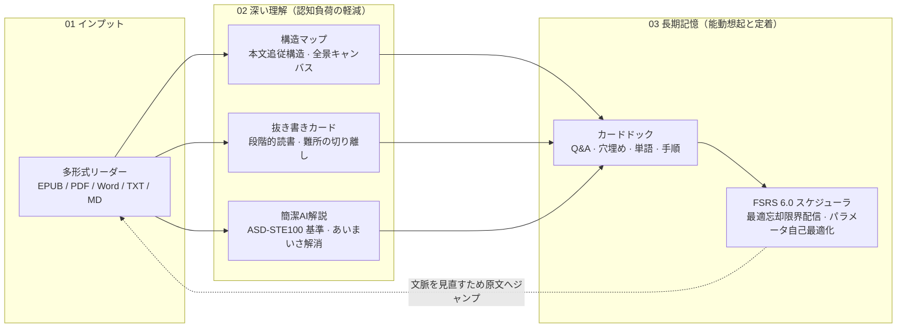

<div align="center">


# Nutation

**まず理解し、そして覚える。「読書」「理解」「記憶」の認知サイクルをひとつに統合したローカルファースト学習ワークベンチ。**

[](./LICENSE)
[](#はじめに)
[](https://www.electronjs.org/)
[](https://react.dev/)
[](https://www.typescriptlang.org/)


[English](./README.md) | [简体中文](./README.zh-CN.md) | 日本語

</div>

<div align="center">

<p><sub>読書の現場：連続した本文を読み進めながら、右側の随文構造が論理展開をリアルタイムにマッピング。</sub></p>
</div>

真の学習の本質は、**「まず深く理解し、その後に確実に覚える」**ことです。

理解を伴わない暗記は単なる丸暗記に過ぎず、応用も利かずすぐに忘却されます。一方で、記憶への定着を伴わない理解は一過性のひらめきに終わり、時間とともに消え去ります。従来のツールはこれらを分断していました——リーダーは閲覧するだけ、ノートは資料を溜め込むだけ、単語帳アプリは文脈から切り離された反復に終始していました。

**Nutation** は、書籍や論文の「読書」、難所の「構造的理解」、そして科学的な「長期記憶」をひとつのシームレスなループにまとめ、完全にローカル環境で完結させます。

---

## 設計思想：理解と記憶の認知ループ



---

## 一、深い理解：構造の把握と読解の障壁排除

認知心理学の研究によれば、巨視的な枠組みを持たずに難解な文章を読み進めると、ワーキングメモリは即座に飽和します。Nutation は理解を支える3つの仕組みを提供します：

### 1. 構造マップ：木を見る前に森を見る

<div align="center">
<video src="docs/assets/readme/structure-ja.mp4" controls width="100%"></video>
<p><sub>本文追従構造 → 構造全景 → 本文へ復帰。巨視的構造と微視的論述を自由に行き来。</sub></p>
</div>

教育心理学の「先行オーガナイザー（Advance Organizer）」理論やスキーマ理論の実証研究が示すように、**細部に入る前に全体構造を把握しておくことで、理解度と学習効率は飛躍的に向上します**：
- **本文追従構造（随文構造）**：現在読んでいる段落の横に寄り添い、全体の論理展開における現在地を明示。ワンクリックで原文への復帰や深掘りが可能です；
- **全景キャンバス（構造全景）**：教材全体の論点、根拠、時系列、対比を俯瞰できる認知マップ。教材全体の論理関係を俯瞰しながら、現在の読書焦点へ自在に行き来できます。

### 2. 抜き書きカード：インクリメンタルリーディング
SuperMemo 創始者 Piotr Woźniak の「インクリメンタルリーディング（漸進的読書）」の知見に基づきます：**一度の通読ですべてを理解し切ることは不可能です。理解できない難所で立ち止まり続けることは学習の流れを阻害します**：
- 難解な段落は独立した抜き書きとして切り离し、注釈や優先度を付与して後から段階的に処理します；
- 抜き書きは元の書籍の CFI / ページ位置を完全に保持しており、いつでもワンクリックで文脈へ復帰できます。

### 3. AI 簡潔解説：技術規格水準のノイズ除去
専門書や学術論文は、複雑な複文や多義語によって意図が伝わりにくくなりがちです。Nutation の AI 解説機能は、航空宇宙産業の厳格な文書規格 **ASD-STE100（簡明技術英語規則）** の原則を取り入れ、多言語に適応させました：
- **あいまいさの解消**：文章中の文法的・意味論的なあいまい箇所を明示；
- **単一意図の短文へ分解**：短文かつ「一文一意」の規則に従い、長大・入れ子の文を明快な論理連鎖へと再構成；
- **専門用語の抽出**：重要な術語を専用の用語リストとして単離。原文の主張や不確実性を曲げることなく、本質的な意味を提示します。

<div align="center">
<video src="docs/assets/readme/ai-explain-ja.mp4" controls width="560"></video>
<p><sub>簡潔解釈：あいまいさの指摘、一文一意への分解、用語抽出。</sub></p>
</div>

---

## 二、長期記憶：能動想起と FSRS アルゴリズム

短時間で得た情報は急速に忘却されます（エビングハウスの忘却曲線）。作業記憶を長期記憶へ転換するには、**適切な間隔を空けた能動想起（Active Recall）**が不可欠です。

<div align="center">
<video src="docs/assets/readme/fsrs-ja.mp4" controls width="760"></video>
<p><sub>FSRS 復習画面：問題提示 → 3D 反転で解答確認 → 4段階の評価。</sub></p>
</div>

### 1. 統合型カードドック（Workbench）
閲覧中いつでも `Ctrl+K`（サイドパネル）または `Ctrl+Alt+K`（独立最前面ウィンドウ）で呼び出し可能：
- **教材に応じた自動ルーティング**：概念論述（Q&Aカード）、数式展開（LaTeX Q&A）、手順（順序穴埋め）、列挙（Cloze穴埋め）、外国語語彙（単語4種カード）に対応；
- **画面キャプチャと画像穴埋め作問（Image Occlusion）**：独立最前面ウィンドウをいつでも呼び出し、「画像穴埋め」を押して画面上の学術図表、解剖図、システム構成図、スライドなどの任意領域をキャプチャ。矩形・楕円・多角形ツールによるドラッグ操作で直感的にマスクを作成し、画像素材はローカル資産庫へ自動保管されます；
- **CardLint 品質チェック**：AI 作問と手動作問の双方を対象とした、完全ローカルの静的品質検証エンジン。Piotr Wozniak の知識定式化原則に基づき、最小情報原則の徹底（過剰な解答長、過長な問題文、過剰な穴埋めの検知）にとどまらず、認知の罠の防止（正誤判定・Yes/No 形式の排除、過度な列挙の抑制、自由想起の合格基準明記の強制）、文脈プレフィックスによるネタバレ防止、見解の帰属元や人名・正式名称の厳格性検証、変動しやすい情報のタイムスタンプ確認、そしてローカル類似検索と連動した重複・競合の検知まで多面的に検証します。

<div align="center">
<video src="docs/assets/readme/occlusion-ja.mp4" controls width="760"></video>
<p><sub>画面キャプチャ＆画像穴埋め作問の完全ループ：グローバルショートカットで起動 → ドラッグで画面領域（本格麻婆豆腐レシピ・材料一覧）をキャプチャ → 矩形・楕円ツールで重要材料を精密に遮蔽 → カード作成から復習画面での出題・答え表示・FSRS評価までの一貫した閉環。</sub></p>
</div>

### 2. 優れた FSRS 6.0 间隔反復アルゴリズムを採用
復習スケジューリングにあたり、FSRS アルゴリズムを考案し無償でオープンソース化してくださった開発者の **[Jarrett Ye (L-M-Sherlock)](https://github.com/L-M-Sherlock)** 氏ならびに **[Open Spaced Repetition](https://github.com/open-spaced-repetition)** コミュニティに深く敬意と感謝の意を表します。

Nutation は最新の **FSRS 6.0 アルゴリズム**（`ts-fsrs` 5.4.2 エンジン）を採用しています：
- **科学的な最適スケジュール**：カードごとの安定性（Stability）、想起可能性（Retrievability）、難易度（Difficulty）に基づき、忘れかける最適なタイミングで復習を提示。最小限の回数で高い記憶定着率を維持します；
- **個別最適化（使えば使うほど正確に）**：内蔵の `fsrs-rs` 最適化機能により、自身のローカル復習ログ（`review_logs`）をもとに 21 次元の重みパラメータを再訓練可能。

---

## プライバシーとローカルファーストの徹底

- **アカウント不要・テレメトリ完全排除**：サインアップは一切不要。利用状況や閲覧履歴が外部サーバーに送信されることはありません。
- **データはローカルに完結**：書庫、抜き書き、カード、復習ログはすべて端末内の SQLite（WAL モード + 厳格なトランザクション）に永続化されます。
- **AI は完全任意かつ透過的**：読書、抜き書き、手動作問、FSRS 復習は完全オフラインで動作します。AI は下書き補助に限定され、ユーザーの明示的な承認なしにデータが保存されることはありません。

---

## 対応フォーマット

| 形式 | ビューア / 取り込み | 主な機能 |
| --- | --- | --- |
| **EPUB · MOBI · AZW3 · FB2 · CBZ** | foliate-js ベースの内蔵エンジン | CFI 規格準拠によりリフロー時も位置ズレなし |
| **PDF** | 高速ネイティブ PDF レンダラ | 連続スクロールと複数ページにまたがるハイライト |
| **Word (.docx) · TXT · Markdown · HTML** | ワンクリック書籍化インポート | 見出し階層構造を保持 |
| **クリップボードのテキスト** | 即時書籍化 | Web の長文記事などを即座に学習対象へ |

---

## はじめに

### 動作要件とインストール
- **Windows 10 / Windows 11 64-bit (x64 / ARM64)** 対応。
- [GitHub Releases](https://github.com/xiongdy54/Nutation/releases) から最新のインストーラ（`.exe`）を入手してください。アップデートやアンインストールを行っても、ローカルデータが削除されることはありません。

### ソースコードからのビルド
```bash
git clone https://github.com/xiongdy54/Nutation.git
cd Nutation
npm install        # Electron ABI に適合したネイティブ SQLite を自動設定
npm run dev        # Vite + Electron の開発モード起動
npm run build      # レンダラーのビルド
npm run dist       # NSIS インストーラの生成
```

---

## 名前の由来：なぜ Nutation なのか？

植物が成長するとき、茎の先端は空間に緩やかな螺旋の円を描きながら、光や重力を感知し、自らの伸びる方向を探します。この自発的な運動を植物学で**回旋点頭運動（circumnutation）**と呼びます。

人間の学びも同じです。一本の決められた直線を急ぐのではなく、いま自分がいる場所から好奇心に従って円を描き、難所があれば立ち止まって根を張り、一歩ずつ確実に伸びていく。

すべての学習者が、自分だけのペースで豊かな知の根を張れることを願っています。

---

## ライセンス・謝辞

- 本プロジェクトは **[GNU AGPL v3.0](./LICENSE)** のもとで公開されています。
- 特別謝辞：**[Jarrett Ye (L-M-Sherlock)](https://github.com/L-M-Sherlock)** 氏および **[Open Spaced Repetition](https://github.com/open-spaced-repetition)** —— 優れた FSRS アルゴリズムスケジューラ（ts-fsrs）およびオプティマイザ（fsrs-rs）を開発・無償公開してくださったことに心より感謝申し上げます。
- [foliate-js](https://github.com/johnfactotum/foliate-js)、[SuperMemo](https://www.supermemo.com/)、ならびに Electron、React、better-sqlite3、KaTeX などのオープンソースエコシステムに心より感謝いたします。
