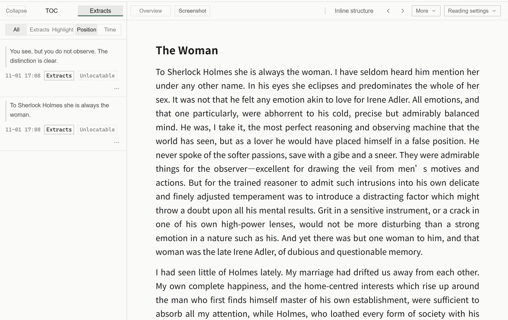
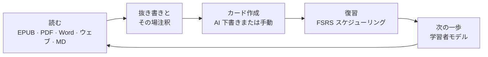
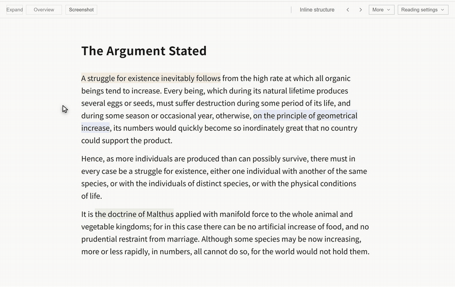
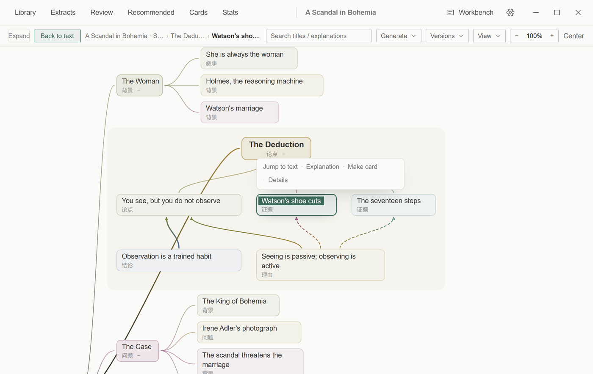
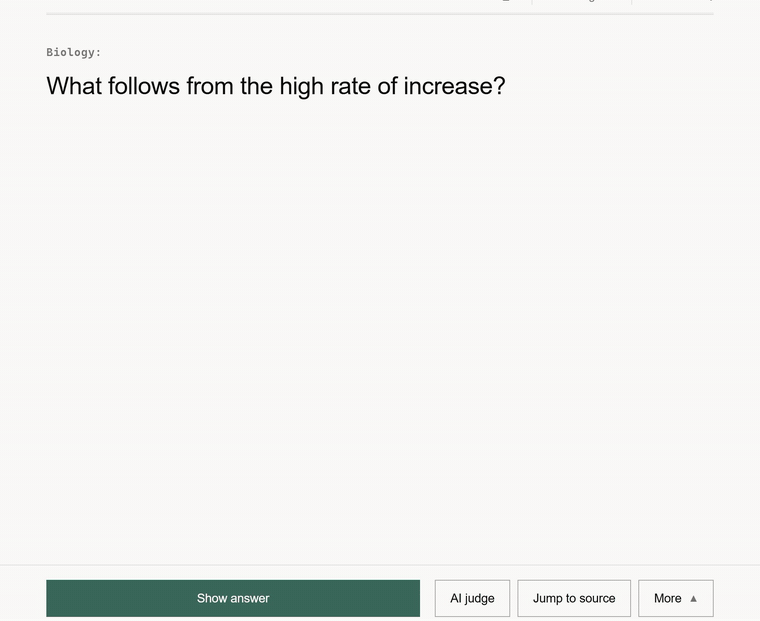
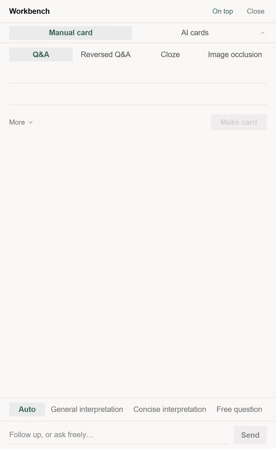
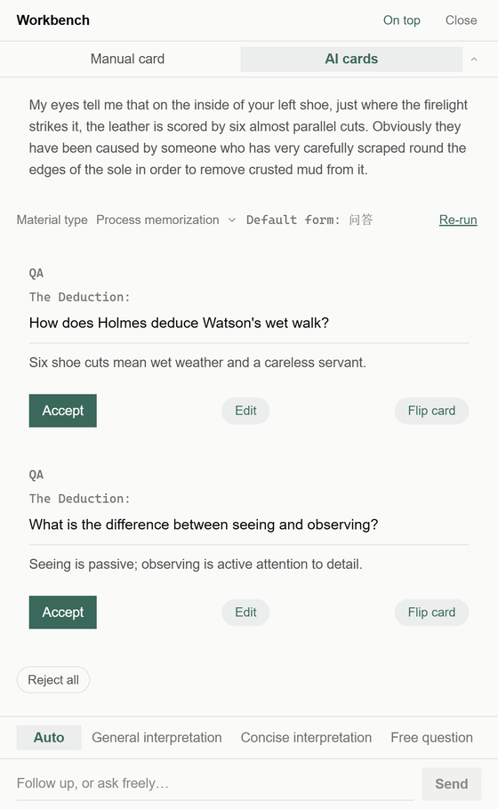
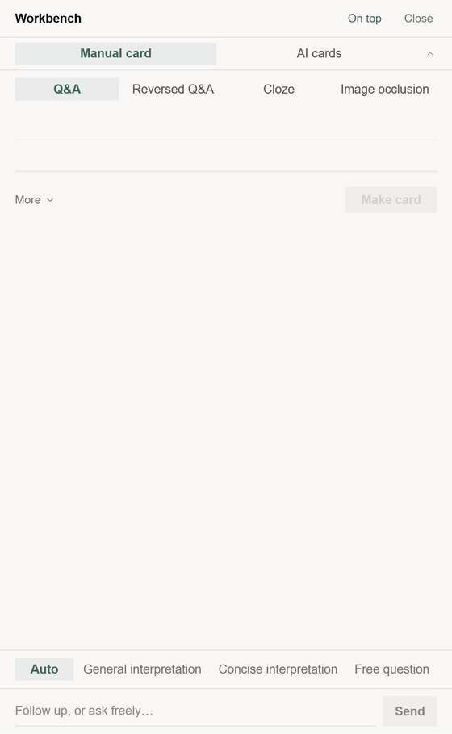
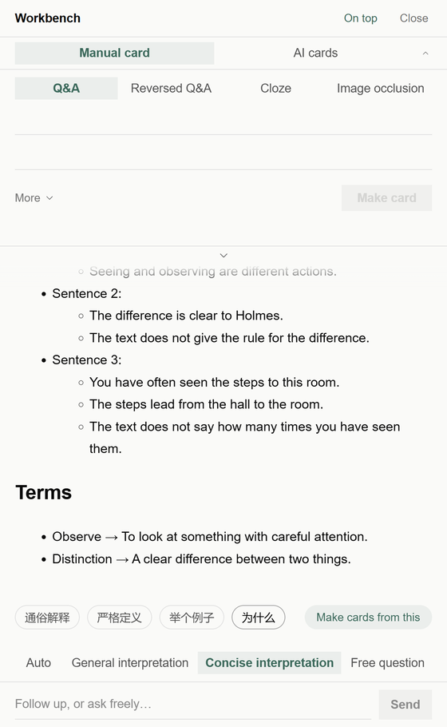

<div align="center">


# Nutation

**ローカルファーストのインクリメンタルリーディング・スタジオ —— 読んで、抜き書きして、記憶する。**

[](./LICENSE)
[](#はじめに)
[](https://www.electronjs.org/)
[](https://react.dev/)
[](https://www.typescriptlang.org/)


[English](./README.md) | [简体中文](./README.zh-CN.md) | 日本語

</div>

<div align="center">

<p><sub>読書の現場：本文・抜き書き・注釈を一画面に。</sub></p>
</div>

Nutation は、読むことと覚えることを同じ一台の PC に置くインクリメンタルリーディングの作業台です。本を開き、重要な段落を抜き書きし、カードにして、FSRS スケジューラが適切なタイミングで戻してくれます。データはすべてローカル。AI は任意で、常に下書きのみ——あなたの確認なしにライブラリへ入ることはありません。

## 仕組み



## ひとつの構造、ふたつの入口

<div align="center">

<p><sub>本文の構造 → 構造全景 → 戻る。二つのビューは同じ一枚の地図です。</sub></p>
</div>

**本文の構造** は、いま読んでいる段落の横に寄り添います。現在のノードが原文に結びつき、そこから原文へジャンプし、解説を求め、枝を深掘りし、全体の地図を開けます。

**構造全景** は、いま読んでいる位置を中心に、材料全体を一枚のキャンバスに置きます。各グループはその構造に合ったレイアウト——アウトライン、グリッド、論証、タイムライン、手順、因果、比較——で並び、パン / ズーム、パンくず、関係の強調、ノード操作は必要なときだけ現れます。二つのビューの間は 420 ms の共有要素トランジションでつながります。

全体の骨組みを先に見たい人もいれば、一段落から出発して外へ広げたい人もいます。Nutation はどちらの方向も支えますが、順番を決めつけません。

<div align="center">

<p><sub>段落のまわりの構造：主張、理由、証拠、そして材料全体での位置。</sub></p>
</div>

地図は設定したモデルで生成されます。生成後はローカルライブラリの一部になり、本文の構造も構造全景もオフラインで見られます。

## FSRS で復習を組み立てる

<div align="center">

<p><sub>答えを表示 → 4 段階の評価 → 次のカード。</sub></p>
</div>

Nutation は **FSRS-6.0**（`ts-fsrs` 5.4.2）を使います。カードごとに安定性と難易度の推定を保ち、次の復習位置を決めます。21 次元の重みは、あなた自身の `review_logs` から設定画面の `fsrs-rs` オプティマイザで再学習できます。学習したパラメータは不変スナップショットで、適用しても未来のスケジューリングだけが変わり、カードの履歴は再計算されません。

復習はドリル式です：4 段階の評価、間隔プレビュー（幅が許すとき）、自動で次のカード、ワンクリック取り消し、原文へジャンプして戻る、そして繰り返し忘れるカード（leech）の検出とレスキュー。ダッシュボードは同じ復習ログから導かれ、別の捏造された数字はありません。

FSRS はオープンなスケジューリングアルゴリズムであり、記憶を保証するものではありません。どのカードをいつ再会させるかを決めるだけで、その瞬間に何をするかはあなたの側にあります。

## ワークベンチはショートカットひとつ先に

<div align="center">

<p><sub>Ctrl+Alt+K で独立ワークベンチを呼び出し。同じパネルはメインウィンドウ右側にもドックします。</sub></p>
</div>

手動カード作成、AI カード作成、AI 解説を一か所に。メインウィンドウでは右側にドック（`Ctrl+K`）、`Ctrl+Alt+K` で独立した常時最前面のウィンドウになり、別の資料を読みながら使えます。どちらも同じコンポーネントなので、片方の変更はもう片方にも反映されます。

手動側は AI サービスなしで動きます。AI 側は下書きのみ。解説パネルは下部にあり、自動・一般解釈・簡潔解釈・自由質問の 4 モードを提供します。タブを切り替えても下書きは残り、タブ間のゴースト下書きは `Alt+Enter` で移せます。

## AI カード作成、素材タイプごとに振り分け

<div align="center">

<p><sub>段落を選ぶかテキストを貼り付けると、素材タイプ・知識ポイント・確認ステップ付きの下書きが返ります。</sub></p>
</div>

Nutation はモデルを呼ぶ前に素材タイプをローカルで判定します。既定のカード形式は、選んだテキストの種類に従います。これはローカルのヒューリスティクスで、最終判定ではありません——手動で上書きして再実行できます。

| 素材タイプ | 既定のカード形式 |
| --- | --- |
| 概念論述 | Q&A（確認画面でフリップ形式に変換可） |
| 公式導出 | Q&A（LaTeX） |
| 手順の暗記 | Q&A（順序の続き） |
| 列挙リスト | 穴埋め（クローズ） |
| 画像素材 | 画像穴埋め |
| 文学 / 詩歌の暗記 | Q&A |
| 語彙 / 単語 | 単語 4 枚セット（和→外 / 外→和 / リスニング / 原文穴埋め） |

下書きはすべて提案です。表と裏を編集し、Q&A をフリップカードに変え、1 枚ずつ、またはまとめて受け入れ、まとめて拒否できます。CardLint がローカル品質チェックを走らせ、キューに入る前に警告を表示します。AI はあなたの確認なしにライブラリへ書き込みません。AI サービスがなくても手動カード作成はそのまま使えます。

入力は選択した範囲か貼り付けたテキストです。製品独自の長さ上限はありません——実際の上限は設定したモデルのコンテキストウィンドウです。

<details>
<summary>下書き確認パネル（静止画）</summary>
<br />
<div align="center">

</div>
</details>

## 簡潔な解説、境界線もはっきりと

<div align="center">

<p><sub>簡潔解釈：曖昧な点、文ごとの説明、複数の読み方、用語。</sub></p>
</div>

解説パネルには自動・一般解釈・簡潔解釈・自由質問があります。**簡潔解釈** は ASD-STE100 の明快さの原則——短い文、一文一義、能動態、統制語彙、情報を足さない、不確実性を保つ——を参考にし、出力言語に適用します。原文の逐語訳ではなく、原文の主張を単純化して消すものでもありません。

出力は構造化されています：曖昧な点（言語表現の障壁だけ）、文ごとの説明、本当に複数の読み方があるときの複数解釈、短い用語集。難しい段落に*入る*ための助けであり、置き換えではありません。

Nutation は **ASD の提携製品でも認証製品でもありません**。標準文書を内蔵していません。解説は間違うことがあり、原文が権威です。出力は読書の補助であり、原文の検証ではありません。

<div align="center">

<p><sub>答えを用語までスクロール。解釈モードのバーは常に下部にあります。</sub></p>
</div>

## そのほか

- **閲読カーネル —— すべてが本になる** —— EPUB・MOBI・AZW3・FB2・CBZ・PDF をそのまま開き、Word・TXT・Markdown・HTML は本として取り込み、貼り付けたテキストも本になります。目次サイドバー、スクロール / ページ送り、複数の紙面外観、前回の正確な位置へ戻る進度。
- **抜き書きとその場注釈** —— 段落を選んで抜き書きし、その場で注釈。サイドバーで注釈を一覧し、抜き書きを一件ずつ復習し、原文の現場へ戻れます。
- **ダッシュボード** —— 一日のアクティビティタイムライン、学習ヒートマップ、到期予測、分野分布、評価内訳。すべてあなた自身のログから。
- **カードブラウザ** —— 検索構文、一括操作、各カードの CardLint 品質結果。
- **学習者モデルと次の一歩** —— ローカルの学習エビデンスから組み立てる「次へ」パネル。学習者メモリはローカルの Markdown ファイルで管理。
- **その他内蔵** —— 知識ポイントとナレッジグラフ、辞書（オンライン + ローカル StarDict / DSL / ECDICT）、AI インサイト付きジャーナル、グローバルショートカットのクイック記録、UDC 分類、スキン、すべて再割り当て可能なショートカット。

## なぜ「Nutation」なのか

植物が成長するとき、その先端は空中でゆっくりと円を描き、周囲を感じ取ってから、進む方向を選びます。この運動は **回転頭運動（circumnutation）** と呼ばれます。地図も、正解もありません。一株一株の植物が、それぞれ自分のリズムで世界を感じ取り、自分の方向を見つけています。

**Nutation** の名前はここから来ています。

学びもまた、そうあるべきだと私は信じています。必修の科目はなく、唯一の道も、到達すべき標準答案もありません。自分の環境から出発し、自分の好奇心に従い、一周また一周と探りながら、少しずつ育っていく。

円を描くことは迷子になることではなく、方向を探しているのです。ゆっくりなのは遅れていることではなく、根を下ろしているのです。

すべての学び手が、あの幼い苗のように、安心して探検し、回り道を堂々と歩み、最後には自分だけの形に育ちますように。

## 対応フォーマット

| フォーマット | 開き方 |
| --- | --- |
| EPUB · MOBI · AZW3 · FB2 · CBZ | 閲読カーネル（foliate-js）でネイティブ表示、CFI アンカーで位置特定 |
| PDF | 内蔵 PDF 閲覧 |
| Word (.docx) · TXT · Markdown · HTML | ワンクリックで本として取り込み |
| 貼り付けたテキスト | 読める本として合成 |

## プライバシーとローカルファースト

- **アカウント不要** —— 登録なしで、開いたらすぐ使える。
- **リモートテレメトリゼロ** —— アカウントもアップロードもありません。学習者モデルが使うインタラクション信号はローカルのデータフォルダにだけ保存され、私たちへ送られることはありません。
- **クラウドゼロ** —— ローカルの SQLite データベースとローカルファイルが唯一のデータ源。AI を設定した場合、リクエストはあなたの PC から選んだプロバイダへ直接送られます。
- **AI は任意** —— 読書・抜き書き・注釈・手動カード・FSRS 復習は AI サービスなしで動きます。AI カード作成・簡潔解釈・新しい地図の生成にはモデル設定が必要です。キーはプロバイダごとに OS レベルのストレージで暗号化され、まとめてオフにできます。

## 技術スタック

| レイヤー | 採用技術 |
| --- | --- |
| デスクトップシェル | Electron 45 + Vite 6 |
| フロントエンド | React 18 + TypeScript（strict モード） |
| 閲読カーネル | foliate-js（vendor 固定スナップショット）+ 防腐層、CFI アンカー |
| ストレージ | SQLite（better-sqlite3、WAL）、トランザクション書き込み + 明示的 persist |
| スケジューリング | `ts-fsrs` 5.4.2（FSRS-6.0）+ `fsrs-rs` オプティマイザ —— あなたの復習ログから 21 次元の重みを学習 |
| AI ゲートウェイ | OpenAI 互換ストリーミング、ローカル Ollama / LM Studio を含むプリセット、キーは safeStorage で暗号化 |
| レンダリング | markdown-it / react-markdown、KaTeX、Milkdown |
| パッケージング | electron-builder —— Windows NSIS インストーラ。macOS / Linux のビルドターゲットもリポジトリにあります |

## はじめに

### ダウンロード

[Releases](https://github.com/xiongdy54/Nutation/releases) ページから Windows インストーラを入手できます。Nutation は **Windows 10/11 の 64 ビット（x64 / ARM64）** 専用です —— 32 ビット（ia32）版は提供されません（Electron 44 以降、Windows 32 ビットバイナリの提供が終了したため）。ウィザード式でインストール先を選択可能。アンインストールしてもデータは削除されません。

### ソースからビルド

必要要件：[Node.js](https://nodejs.org/) 22.12 以上と npm。

Linux では Electron のシステムライブラリも必要です —— postinstall がネイティブ SQLite モジュールを検証するために Electron バイナリを起動します：

```bash
# Debian / Ubuntu（Ubuntu 24.04 以降は libasound2 が libasound2t64 に改名）
sudo apt-get install -y libgtk-3-0 libnss3 libxss1 libgbm1 libasound2 xvfb
# Fedora / RHEL / Amazon Linux
sudo dnf install -y gtk3 nss libXScrnSaver mesa-libgbm alsa-lib xorg-x11-server-Xvfb
```

ビルドのみで Electron を起動しないステップ（CI のビルドジョブなど）では、`NUTATION_SKIP_ABI_VERIFY=1` を設定すると ABI 検証をスキップできます。

```bash
git clone https://github.com/xiongdy54/Nutation.git
cd Nutation
npm install        # Electron 向けネイティブ SQLite モジュールを自動でピン留め
npm run dev        # 開発モード（Vite + Electron、ホットリロード）
```

本番ビルドとパッケージング：

```bash
npm run build      # レンダラを dist/ にビルド
npm start          # ビルド済みアプリを起動
npm run dist       # Windows NSIS インストーラを release/ に生成
npm run dist:mac   # macOS パッケージ（macOS 上でビルド）
npm run dist:linux # Linux パッケージ（Linux 上でビルド）
```

## データの保存場所

すべてのデータはあなたの PC に保存されます：

- インストール版：`%APPDATA%\Nutation\`
- 開発版：`%APPDATA%\Nutation-dev\`

古い `incremental-reading-dev` フォルダは初回起動時に新しい場所へ移行されます。名前変更に失敗した場合は、空の新しいフォルダを作らず、古いフォルダをそのまま使い続けます。フォルダには `library.db`（ライブラリ・カード・復習ログ）、`dictionary.db`、`learner.db`、バックアップ、学習者メモリが入っています。手動・自動バックアップを内蔵し、フォルダごとコピーすれば完全なバックアップになります。アンインストールしてもこのフォルダは消えません。

## ロードマップ

- GitHub Releases 経由の自動更新チャネル（electron-updater は組み込み済み）
- macOS の署名 / 公証パッケージと、安定した Linux チャネル
- 任意のクラウド同期 —— ローカルライブラリが常に唯一のデータ源であり続けます

Nutation は活発に開発中です。フィードバックと問題報告を歓迎します。

## コントリビューション

本プロジェクトは現在、単一作者が設計ドキュメント駆動で開発しています。使用感のフィードバック・問題報告・バグの再現手順を歓迎します —— [issue](https://github.com/xiongdy54/Nutation/issues) を立ててください。コードのコントリビューションはプロジェクトのライセンスに従います。

## ライセンス

本プロジェクトは [GNU Affero General Public License v3.0](./LICENSE) の下でライセンスされています。同ライセンスの条件に従って使用・研究・改変・頒布できます。改変版をネットワークサービスとして提供する場合、AGPL により利用者へ対応するソースコードを提供する必要があります。

## 謝辞

- [foliate-js](https://github.com/johnfactotum/foliate-js) —— EPUB / MOBI 閲読カーネル
- [ts-fsrs](https://github.com/open-spaced-repetition/ts-fsrs) と [fsrs-rs](https://github.com/open-spaced-repetition/fsrs-rs) —— FSRS スケジューラとオプティマイザ（Open Spaced Repetition）
- [SuperMemo](https://www.supermemo.com/) —— 本プロジェクトの着想源であるインクリメンタルリーディングの方法論
- Electron · React · Vite · better-sqlite3 · pdf.js · KaTeX · Milkdown、そしてそれらを支えるオープンソースコミュニティ

<details>
<summary>デモ素材と AI 応答について</summary>

スクリーンショットのデモライブラリは、パブリックドメインの抜粋で構成しています：魯迅『孔乙己』（中国語 UI）とコナン・ドイル『ボヘミアの醜聞』（英語 UI）。

アニメーション内の AI 応答は、Nutation の実際の AI ゲートウェイを通して、ローカルの決定論的テストプロバイダからストリーミングされています。UI、ストリーミング、下書き、編集、確認の経路は実物のアプリです。応答テキストは再現性のために事前に用意したもので、特定の商用モデルを示唆するものではありません。

日本語 README は英語 UI のスクリーンショットを使用しています。アプリの UI 自体は 简体中文・繁體中文・English・日本語 に対応しています。

</details>
