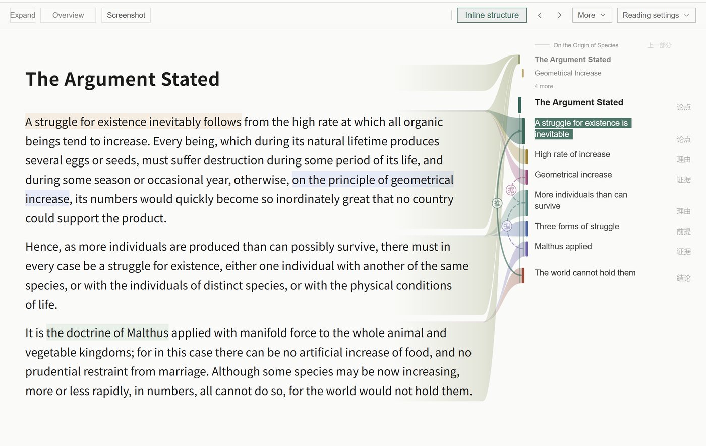
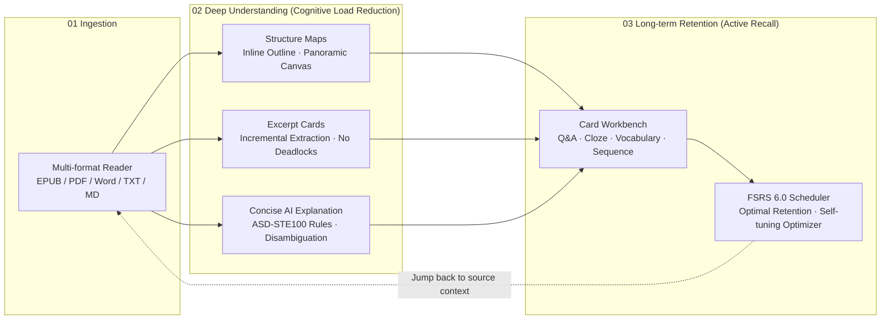
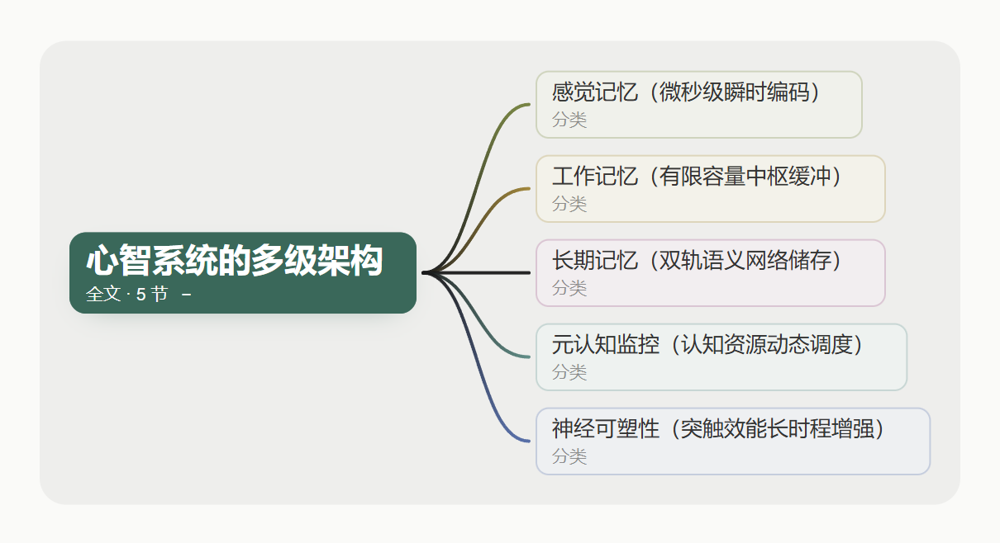
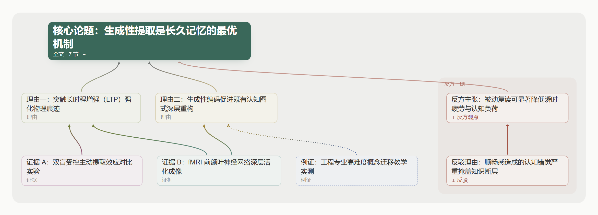
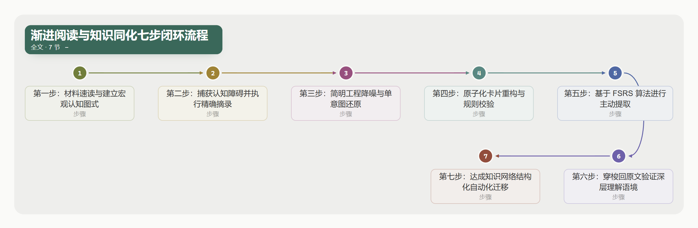
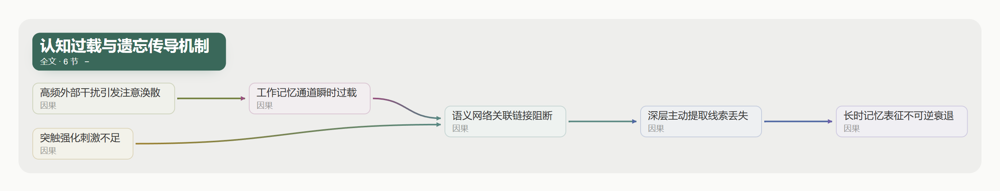
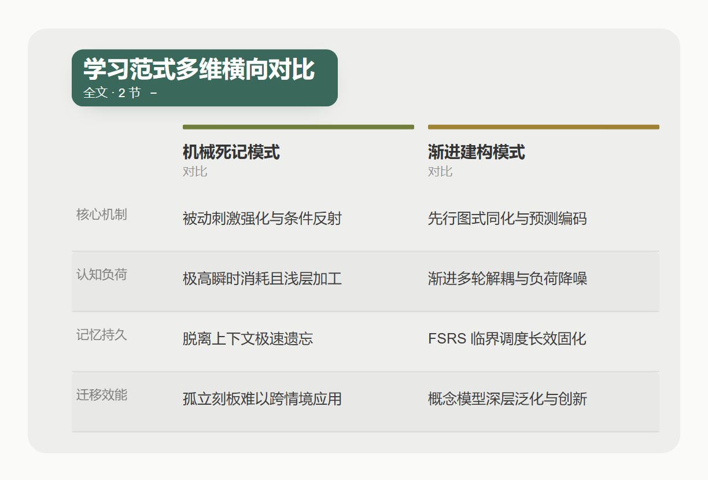

<div align="center">


# Nutation

**Understand first, remember deeply. A local-first workbench uniting deep reading, comprehension, and retention into a single seamless loop.**

[](./LICENSE)
[](#getting-started)
[](https://www.electronjs.org/)
[](https://react.dev/)
[](https://www.typescriptlang.org/)


English | [简体中文](./README.zh-CN.md) | [日本語](./README.ja.md)

</div>

<div align="center">

<p><sub>The reading environment: immersive multi-paragraph prose with dynamic inline structure mapping the author's logical progression.</sub></p>
</div>

At its core, genuine learning consists of two continuous phases: **first understanding, then remembering**.

Memorizing without understanding leads to brittle, useless rote learning that fades quickly and cannot be transferred. Conversely, understanding without deliberate retention results in fleeting epiphanies that vanish within days. Conventional software isolates these steps: reading apps offer passive consumption, note-taking apps accumulate static text, and flashcard apps force isolated drills out of context.

**Nutation** unites reading, structural comprehension, and spaced retention into one unified, local-first workbench.

---

## Architecture: The Cognitive Loop



---

## 1. Deep Understanding: Schemas & Barrier Elimination

Cognitive science proves that without a high-level cognitive schema, working memory is rapidly exhausted by complex syntax and dense prose. Nutation delivers three coordinated mechanisms for comprehension:

### 1. Structure Maps: Forest Before Trees

<div align="center">
<video src="docs/assets/readme/structure-en.mp4" controls width="100%"></video>
<p><sub>Inline structure → panoramic overview → back to reader. Seamless transition between macro structure and micro detail.</sub></p>
</div>

Rooted in David Ausubel’s *Advance Organizer Theory* and cognitive schema research, empirical studies demonstrate that **establishing macroscopic structure prior to details significantly improves comprehension depth and recall**:
- **Inline Structure**: Anchored dynamically beside the paragraph you are reading, displaying exact hierarchical context with one-click drill-downs;
- **Panoramic Canvas (Structure Atlas)**: A global canvas mapping claims, rationale, timelines, and contrasts across the entire material, allowing learners to inspect overarching conceptual relationships while maintaining instant focus on their current reading point.

#### Structure Atlas: 7 Specialized Cognitive Layouts

To faithfully reflect the internal logic of diverse knowledge domains, Nutation's Structure Atlas provides 7 specialized cognitive layouts powered by Swiss typographic geometry. Whether analyzing taxonomies, historical progressions, algorithmic pipelines, or academic debates, each concept is mapped clearly:

1. **Tree Layout (Horizontal Fan Tree · Tree)**: Hierarchical decomposition with smooth Bézier branches, ideal for taxonomy trees and multi-level outlines.
<div align="center">

</div>

2. **Grid Layout (Matrix Tiles · Grid)**: Modular matrix tiles arranged in balanced parallel columns, ideal for peer concepts, cognitive subsystems, and categorical inventories.
<div align="center">

</div>

3. **Argument Layout (Argumentation Map · Argument)**: Primary thesis anchored at top, with supporting reasons and empirical evidence converging upward, complemented by a dedicated counter-claim zone and rebuttal arcs on the right.
<div align="center">

</div>

4. **Timeline Layout (Proportional Chronological Timeline · Timeline)**: Horizontally scaled along historical time with scale rulers, alternating dual lanes, and fault compression for long eras, ideal for intellectual histories and technological evolutions.
<div align="center">

</div>

5. **Chain Layout (Step-by-Step Chain · Chain)**: Sequentially numbered circular badges (1–7) with directional flow arrows and serpentine switchbacks, strictly modeling step-by-step procedures and cognitive feedback loops.
<div align="center">

</div>

6. **Layered Layout (Causal DAG · Layered)**: Left-to-right cascading directed acyclic graph mapping causal transmission, systemic overload, and multi-factor deduction chains.
<div align="center">

</div>

7. **Compare Layout (Multi-Dimensional Matrix Table · Compare)**: Distinct colored header strips per entity, left-hand dimension labels, and alternating zebra-striped comparison rows for multi-model evaluation.
<div align="center">

</div>

### 2. Excerpting: Incremental Processing & De-escalation
Inspired by Piotr Woźniak’s pioneering *Incremental Reading* philosophy: **A reader cannot digest every complex concept on first pass. Stalling on difficult obstacles destroys reading flow**:
- Extract difficult passages into standalone excerpt items with customizable annotation layers and priorities for asynchronous processing;
- Every excerpt retains native CFI / page anchors, enabling instant navigation back to the original context at any future date.

### 3. Concise AI Explanation: Technical Standard-grade Clarity
Academic and technical literature is frequently obscured by convoluted clauses, polysemy, and stylistic ambiguity. Nutation implements an AI explanation module adapted from the aerospace industry's **ASD-STE100 (Simplified Technical English)** standard:
- **Disambiguation**: Identifies structural, syntactic, or terminological ambiguities;
- **Single-Intent Sentence Decomposition**: Enforces concise sentences and strict "one idea per sentence" rules, untangling nested clauses into clear causal chains;
- **Glossary Isolation**: Isolates domain terminology into clear definitions while preserving original nuances and uncertainties without patronizing over-summarization.

<div align="center">
<video src="docs/assets/readme/ai-explain-en.mp4" controls width="560"></video>
<p><sub>Structured explanation: linguistic disambiguation, decomposed sentences, and isolated terminology.</sub></p>
</div>

---

## 2. Long-term Retention: Active Recall & FSRS 6.0

Short-term memory decays exponentially (the Ebbinghaus Forgetting Curve). Transitioning short-term working memory into long-term retention requires **deliberate active recall scheduled across increasing intervals**.

<div align="center">
<video src="docs/assets/readme/fsrs-en.mp4" controls width="760"></video>
<p><sub>FSRS review session: active recall prompt → 3D card reveal → 4-grade rating feedback.</sub></p>
</div>

### 1. Integrated Card Workbench
Summoned in place (`Ctrl+K`) or as an independent, always-on-top window (`Ctrl+Alt+K`):
- **Heuristic Card Routing**: Automatically detects material archetypes (conceptual statements → Q&A, mathematical derivations → LaTeX Q&A, sequential procedures → sequential fill cards, enumerations → Cloze deletions, vocabulary → 4-way language cards);
- **Screen Capture & Image Occlusion**: Summon the independent always-on-top workbench from anywhere, click "Image Occlusion" to capture arbitrary screen regions (such as diagrams, anatomical charts, or workflow maps in your browser), and draw occlusion masks with rectangle, ellipse, and polygon tools to generate image-based cards, with all assets safely stored in your local asset repository;
- **CardLint Quality Engine**: A strictly local, static validation engine applied equally to AI-generated and manually authored cards. Grounded in Piotr Wozniak's knowledge formulation principles, it extends far beyond the Minimum Information Principle (intercepting overloaded answers, overlong prompts, and excessive cloze deletions): it systematically intercepts cognitive pitfalls (preventing yes/no questions and broad enumerations, enforcing explicit recall thresholds for collection questions), guards against clue leakage in context prefixes, enforces academic rigour (requiring view attributions and full entity names), prompts for date stamps on volatile facts, and coordinates with local similarity search to prevent redundant or conflicting cards.

<div align="center">
<video src="docs/assets/readme/occlusion-en.mp4" controls width="760"></video>
<p><sub>Cross-app screen capture & image occlusion full-loop: global shortcut summons workbench → drag-to-crop screen region (authentic Mapo Tofu recipe) → precise rectangle & ellipse occlusion on key ingredient targets → one-click card creation & seamless review loop with question prompt, answer reveal, and FSRS grading.</sub></p>
</div>

### 2. Powered by the Advanced FSRS 6.0 Algorithm
For review scheduling, we extend our heartfelt gratitude to open-source developer **[Jarrett Ye (L-M-Sherlock)](https://github.com/L-M-Sherlock)** and the **[Open Spaced Repetition](https://github.com/open-spaced-repetition)** community for designing and generously open-sourcing the FSRS algorithm.

Nutation adopts the modern **FSRS 6.0 algorithm** (via the `ts-fsrs` 5.4.2 engine):
- **Accurate Mathematical Scheduling**: Tracks Stability ($S$), Retrievability ($R$), and Difficulty ($D$) per card to target precise review intervals at the optimum threshold before memory lapse, achieving high retention with fewer total reviews;
- **Personalized Self-Optimization**: Bundles the native `fsrs-rs` optimizer to train 21 personalized weight parameters directly on your own historical `review_logs` ("the more you review, the more accurate the scheduling becomes").

---

## Privacy & Local-First Guarantees

- **Zero Accounts, Zero Telemetry**: No registration required. No usage metrics or personal data are ever tracked or uploaded.
- **Complete Data Sovereignty**: All books, excerpts, cards, and scheduling logs reside in your local SQLite database (WAL mode + strict transaction commits).
- **AI is Strictly Optional and Transparent**: Reading, excerpting, card authoring, and FSRS reviews work 100% offline. AI only acts as a drafting assistant—no data ever enters your library without explicit confirmation.

---

## Supported Formats

| Format | Engine / Ingestion | Features |
| --- | --- | --- |
| **EPUB · MOBI · AZW3 · FB2 · CBZ** | Foliate-js custom runtime | Strict CFI anchor preservation across reflows |
| **PDF** | Native high-performance renderer | Seamless scrolling and continuous cross-page highlights |
| **Word (.docx) · TXT · Markdown · HTML** | Ingestion pipeline | Structural heading hierarchy preserved |
| **Pasted Text** | Instant compilation | Convert clipboard materials into structured local books |

---

## Getting Started

### Installation
- **Windows 10 / Windows 11 64-bit (x64 / ARM64)**.
- Download the installer (`.exe`) matching your CPU architecture from [GitHub Releases](https://github.com/xiongdy54/Nutation/releases): `...-win-x64-setup.exe` for Intel/AMD, `...-win-arm64-setup.exe` for Windows on ARM. In-app updates pick the right package automatically. Upgrades and uninstalls will never delete your local library databases.

### Building from Source
```bash
git clone https://github.com/xiongdy54/Nutation.git
cd Nutation
npm install        # Automatically locks native SQLite modules to Electron ABI
npm run dev        # Launch Vite + Electron dev environment with HMR
npm run build      # Compile renderer bundles
npm run dist       # Build NSIS production package
```

---

## Why "Nutation"?

As a seedling grows, its tip traces gentle, continuous spiral loops through 3D space, actively sensing light, gravity, and obstacles to find its optimal upward trajectory. Botanists call this phenomenon **circumnutation**.

Human learning is never a linear sprint. Like that seedling, genuine mastery demands that you explore in gradual spirals from your current vantage point, pause to root deeply when encountering difficulties, and expand step by step.

May every learner find their own natural rhythm of growth.

---

## License & Acknowledgements

- Licensed under **[GNU AGPL v3.0](./LICENSE)**.
- Special thanks to **[Jarrett Ye (L-M-Sherlock)](https://github.com/L-M-Sherlock)** and **[Open Spaced Repetition](https://github.com/open-spaced-repetition)** for developing and open-sourcing the FSRS scheduler (ts-fsrs) and optimizer (fsrs-rs).
- Built on [foliate-js](https://github.com/johnfactotum/foliate-js), [SuperMemo](https://www.supermemo.com/), Electron, React, better-sqlite3, and KaTeX.
