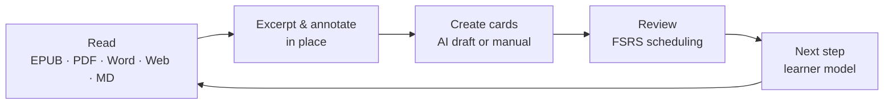
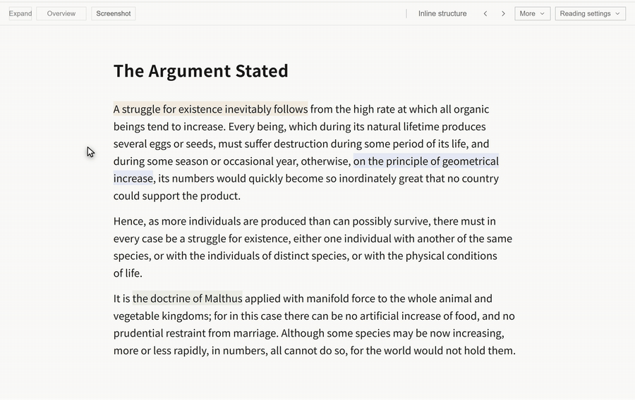
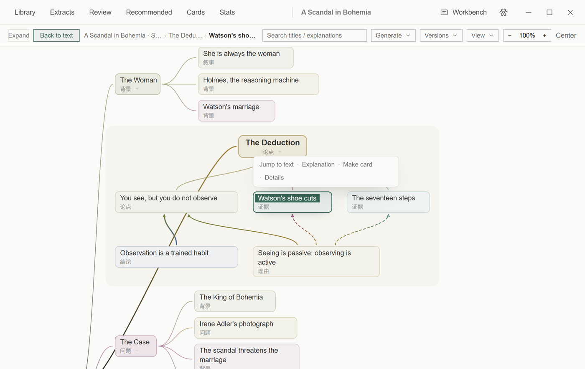
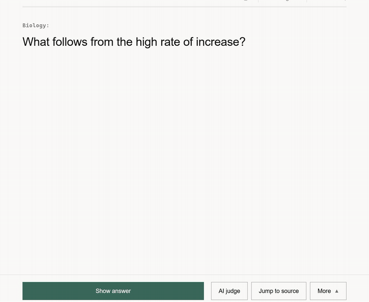
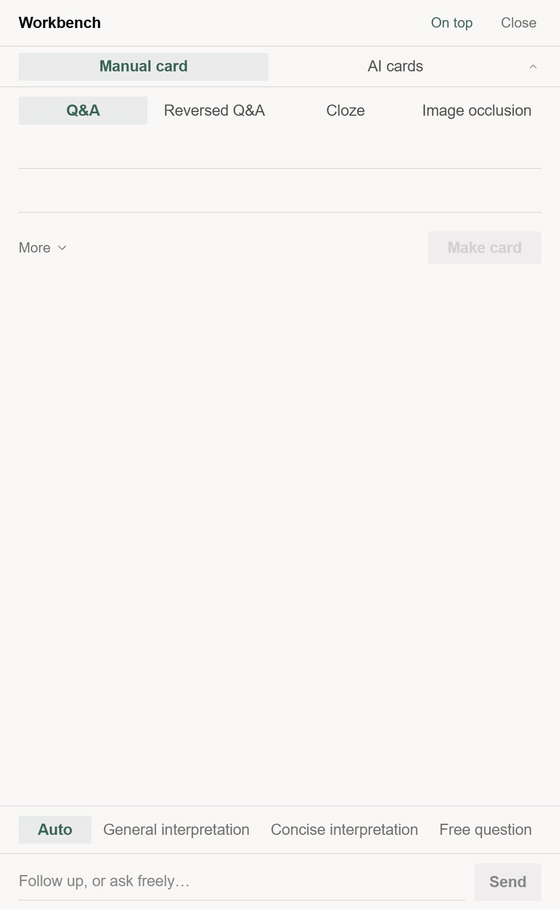
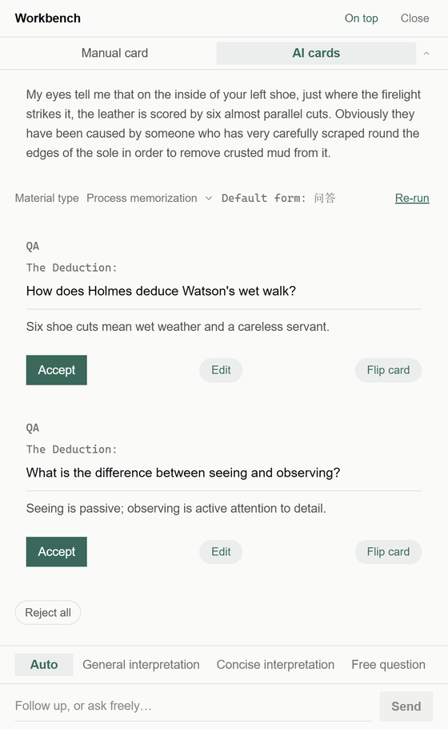
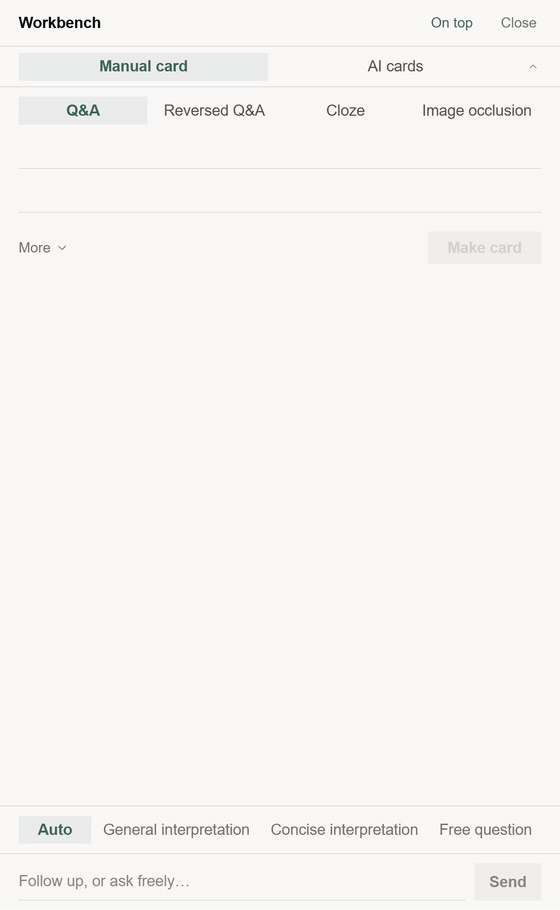
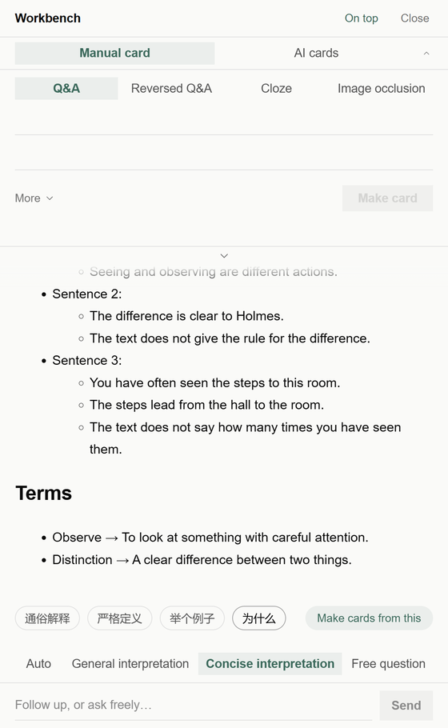

<div align="center">


# Nutation

**A local-first incremental reading studio — read, excerpt, remember.**

[](./LICENSE)
[](#getting-started)
[](https://www.electronjs.org/)
[](https://react.dev/)
[](https://www.typescriptlang.org/)


English | [简体中文](./README.zh-CN.md) | [日本語](./README.ja.md)

</div>

<div align="center">

<p><sub>The reading desk: the text, your excerpts, and every annotation one click away.</sub></p>
</div>

Nutation is a desktop studio for incremental reading. It keeps the whole loop on your machine: open a book, mark what matters, turn it into cards, and let an FSRS scheduler bring it back at the right time. Everything is local; AI is optional, and when you use it, it only drafts — nothing enters your library without your confirmation.

## How it works



## One structure, two ways to see it

<div align="center">

<p><sub>Inline structure → overview → back. The two views are the same map.</sub></p>
</div>

**Inline structure** sits beside the passage you are reading. The current node is anchored to the text; from there you can jump to the source, ask for an explanation, deepen the branch, or open the whole map.

**Overview** puts the material on one canvas, centered on where you are reading. Each group is laid out by its own structure — outline, grid, argument, timeline, steps, causal chain, comparison — and pan/zoom, breadcrumbs, relation emphasis and node actions stay out of the way until you need them. The handoff between the two views is a 420 ms shared-element transition.

Some readers like to see the whole skeleton first; others start from a passage and work outward. Nutation supports both directions; it does not prescribe one order.

<div align="center">

<p><sub>The overview around the passage: claim, reasons, evidence, and the story around them.</sub></p>
</div>

Maps are generated with the model you configure. Once generated, they are part of your local library: the inline view and the overview work offline.

## Spaced repetition, scheduled by FSRS

<div align="center">

<p><sub>Reveal → four grades → next card.</sub></p>
</div>

Nutation uses **FSRS-6.0** through `ts-fsrs` 5.4.2. The scheduler keeps a stability and difficulty estimate for every card and uses them to place the next review. The 21-dimensional weights can be retrained from your own `review_logs` with the `fsrs-rs` optimizer in Settings. A trained parameter set is an immutable snapshot: applying it changes future scheduling only, never the history of a card.

The review session is built for continuous drill: four grades with interval previews (space permitting), auto-advance, one-click undo, jump to the source and back, and leech detection with a rescue flow for cards that keep lapsing. The dashboard is derived from the same review logs — no separate, invented numbers.

FSRS is an open scheduling algorithm, not a promise that you will remember. It decides *when* a card is worth seeing again; what you do with that moment is still yours.

## The workbench is one shortcut away

<div align="center">

<p><sub>Ctrl+Alt+K opens the standalone workbench. The same panel also docks in the main window.</sub></p>
</div>

The workbench puts manual card creation, AI card creation and AI explanation in one place. In the main window it docks on the right (`Ctrl+K`); with `Ctrl+Alt+K` it becomes a standalone, always-on-top window that stays with you while you read something else. Both are the same component, so a change in one is a change in the other.

The manual side works without any AI service. The AI side only drafts; the explanation panel sits at the bottom, with Auto, General interpretation, Concise interpretation and Free question modes. Drafts survive tab switches, and the cross-tab ghost lets you carry text from one side to the other with `Alt+Enter`.

## AI-assisted cards, routed by material type

<div align="center">

<p><sub>Select a passage or paste text; the draft arrives with a material type, knowledge points and a confirmation step.</sub></p>
</div>

Nutation routes the material locally before calling a model: the default card form follows the kind of text you selected. The route is a local heuristic, not a verdict — you can override it and re-run.

| Material type | Default card form |
| --- | --- |
| Concept | Q&A (convertible to a flip card) |
| Formula | Q&A with LaTeX |
| Sequence | Q&A (sequence continuation) |
| Enumeration | Cloze |
| Image | Image occlusion |
| Literature / poetry | Q&A |
| Vocabulary | Four-card set (recognition / recall / listening / sentence cloze) |

Every draft is a proposal. You can edit the front and back, turn a Q&A into a flip card, accept one card or the whole batch, or reject it. CardLint runs a local quality pass and surfaces warnings before the card enters the queue. AI never writes into your library without your confirmation; without an AI service, manual card creation works exactly the same.

The input is a selected passage or pasted text. There is no separate product-level length cap — the practical limit is the context window of the model you configured.

<details>
<summary>Draft panel (still)</summary>
<br />
<div align="center">

</div>
</details>

## Concise explanation, with the limits stated

<div align="center">

<p><sub>Concise interpretation: ambiguity points, sentence-by-sentence explanation, multiple readings, terms.</sub></p>
</div>

The explanation panel offers Auto, General interpretation, Concise interpretation and Free question. **Concise interpretation** borrows the clarity principles of ASD-STE100 — short sentences, one idea per sentence, active voice, controlled terms, no added information, preserved uncertainty — and applies them to the output language. It is not a translation of the source, and it does not simplify away the source's claims.

The output is structured: ambiguity points (only language-level obstacles), a sentence-by-sentence explanation, multiple readings when the text genuinely supports more than one, and a short term list. The goal is to make a difficult passage easier to *enter*, not to replace it.

Nutation is **not affiliated with or certified by ASD**, and the standard's text is not embedded in the product. An explanation can be wrong; the source text remains the authority. Treat the output as a reading aid, not as a verification of the source.

<div align="center">

<p><sub>The answer scrolls to the terms; the mode bar stays at the bottom.</sub></p>
</div>

## Also in the studio

- **Reading kernel — everything is a book** — EPUB, MOBI, AZW3, FB2, CBZ and PDF open directly; Word, TXT, Markdown and HTML import as books; pasted text becomes a book. TOC sidebar, scroll or paginated modes, several paper looks, and progress that returns you to the exact spot.
- **Excerpts & annotations** — select a passage to excerpt it, annotate in place, browse annotations in a sidebar, review excerpts one at a time, and jump back to the source passage.
- **Dashboard** — a per-day activity timeline, learning heatmap, due forecast, domain distribution and grade mix, all derived from your own logs.
- **Card browser** — query syntax, batch operations, and the quality findings that CardLint recorded for each card.
- **Learner model & next step** — a structured “Next” panel built from local learning evidence; learner memory is kept as local Markdown files.
- **Also built in** — knowledge points and a knowledge graph, dictionary (online + local StarDict / DSL / ECDICT), journal with AI insight, quick capture with global shortcuts, UDC domain classification, skins, and remappable shortcuts.

## Why "Nutation"?

When a plant grows, its tip slowly draws circles in the air, sensing its surroundings before choosing a direction. This movement is called **circumnutation**. It has no map, and no standard answer. Every plant feels the world at its own rhythm and finds its own way.

**Nutation** is named after this.

I believe learning should be the same: no compulsory subjects, no single path, and no standard answer you are required to reach. Start from your own environment, follow your own curiosity, probe circle by circle, and grow bit by bit.

Circling is not being lost — it is searching for direction. Being slow is not falling behind — it is taking root.

May every learner, like that young seedling, explore without fear, take detours without regret, and finally grow into a shape that belongs only to themselves.

## Supported formats

| Format | How it opens |
| --- | --- |
| EPUB · MOBI · AZW3 · FB2 · CBZ | Native reader kernel (foliate-js), CFI anchors |
| PDF | Built-in PDF reading |
| Word (.docx) · TXT · Markdown · HTML | One-click import as a book |
| Pasted text | Becomes a synthesized, readable book |

## Privacy & local-first

- **Zero account** — no sign-up, it works the moment it opens.
- **Zero remote telemetry** — no account and no upload. Interaction signals used by the learner model are stored locally in your data folder and never sent to us.
- **Zero cloud** — a local SQLite database and local files are the only sources of truth. AI requests, when configured, go directly from your machine to the provider you chose.
- **AI optional** — reading, excerpts, annotations, manual cards and FSRS review work without an AI service. AI card generation, concise explanation and new map generation need a configured model. Keys are encrypted per provider with OS-level storage and can be turned off entirely.

## Tech stack

| Layer | Choice |
| --- | --- |
| Desktop shell | Electron 45 + Vite 6 |
| Frontend | React 18 + TypeScript (strict) |
| Reader kernel | foliate-js (vendored snapshot) behind an anti-corruption layer, CFI anchors |
| Storage | SQLite (better-sqlite3, WAL), transactional writes with explicit persist |
| Scheduling | `ts-fsrs` 5.4.2 (FSRS-6.0) + `fsrs-rs` optimizer — 21-dimensional weights trained from your own review logs |
| AI gateway | OpenAI-compatible streaming, presets including local Ollama / LM Studio, keys encrypted with safeStorage |
| Rendering | markdown-it / react-markdown, KaTeX, Milkdown |
| Packaging | electron-builder — Windows NSIS installer; macOS and Linux build targets are also in the repo |

## Getting started

### Download

Grab the Windows installer from the [Releases](https://github.com/xiongdy54/Nutation/releases) page. Nutation requires **Windows 10/11 64-bit (x64 / ARM64)** — there is no 32-bit (ia32) build, since Electron 44+ no longer ships Windows 32-bit binaries. The setup wizard lets you pick the installation directory; uninstalling never deletes your data.

### Build from source

Prerequisites: [Node.js](https://nodejs.org/) 22.12+ and npm.

On Linux, Electron also needs system libraries — the postinstall step starts the Electron binary to verify the native SQLite module:

```bash
# Debian / Ubuntu (Ubuntu 24.04+ replaces libasound2 with libasound2t64)
sudo apt-get install -y libgtk-3-0 libnss3 libxss1 libgbm1 libasound2 xvfb
# Fedora / RHEL / Amazon Linux
sudo dnf install -y gtk3 nss libXScrnSaver mesa-libgbm alsa-lib xorg-x11-server-Xvfb
```

If a step only builds the app and never runs Electron (for example a CI build job), set `NUTATION_SKIP_ABI_VERIFY=1` to skip the ABI verification.

```bash
git clone https://github.com/xiongdy54/Nutation.git
cd Nutation
npm install        # pins the native SQLite module for Electron automatically
npm run dev        # development mode (Vite + Electron, hot reload)
```

Production build and packaging:

```bash
npm run build      # build the renderer into dist/
npm start          # run the app from the built output
npm run dist       # produce the Windows NSIS installer into release/
npm run dist:mac   # macOS package (build on macOS)
npm run dist:linux # Linux package (build on Linux)
```

## Where your data lives

All data stays on your machine:

- Installed builds: `%APPDATA%\Nutation\`
- Development builds: `%APPDATA%\Nutation-dev\`

The old `incremental-reading-dev` folder is migrated to the new location on first launch; if the rename fails, Nutation keeps using the old folder rather than starting a new, empty one. The folder contains `library.db` (library, cards, review logs), `dictionary.db`, `learner.db`, backups and learner memory files. Built-in manual and automatic backups live alongside; copying this folder is a full backup. Uninstalling the app does not delete it.

## Roadmap

- Auto-update through GitHub Releases (electron-updater is already wired)
- Signed and notarized macOS packages, and a stable Linux channel
- Optional cloud sync — the local library remains the single source of truth

Nutation is under active development. Feedback and issue reports are welcome.

## Contributing

The project is currently developed in a single-author, design-doc-driven workflow. Issue reports, usage feedback and bug reproductions are very welcome — open an [issue](https://github.com/xiongdy54/Nutation/issues). Code contributions land under the project's license.

## License

Licensed under the [GNU Affero General Public License v3.0](./LICENSE). You may use, study, modify and redistribute Nutation under its terms; if you run a modified version as a network service, the AGPL requires you to offer its source to users.

## Acknowledgments

- [foliate-js](https://github.com/johnfactotum/foliate-js) — the EPUB/MOBI reader kernel
- [ts-fsrs](https://github.com/open-spaced-repetition/ts-fsrs) & [fsrs-rs](https://github.com/open-spaced-repetition/fsrs-rs) — the FSRS scheduler and optimizer (Open Spaced Repetition)
- [SuperMemo](https://www.supermemo.com/) — the incremental reading methodology that inspired this project
- Electron · React · Vite · better-sqlite3 · pdf.js · KaTeX · Milkdown · and the open-source ecosystem around them

<details>
<summary>About the demo library and the AI responses</summary>

The screenshots use a demo library built from public-domain excerpts: Lu Xun's *Kong Yiji* (Chinese UI) and Arthur Conan Doyle's *A Scandal in Bohemia* (English UI).

The AI responses in the animated demos are streamed through Nutation's real AI gateway from a local deterministic test provider. The UI, streaming, drafting, editing and confirmation paths are the real application; the response text is prewritten so the demos are reproducible. No commercial model is implied.

The English README uses screenshots of the English UI; the Chinese README uses the Chinese UI. The Japanese README uses the English screenshots. The app UI itself supports 简体中文, 繁體中文, English and 日本語.

</details>
