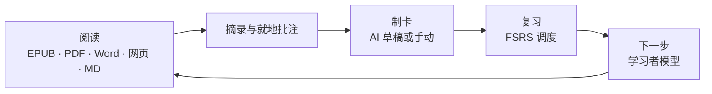
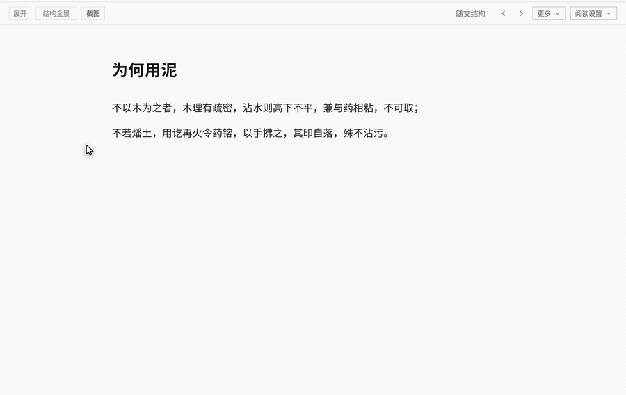
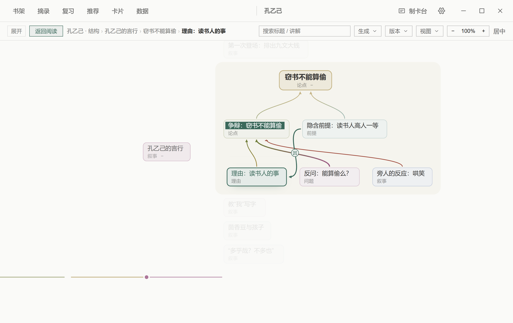
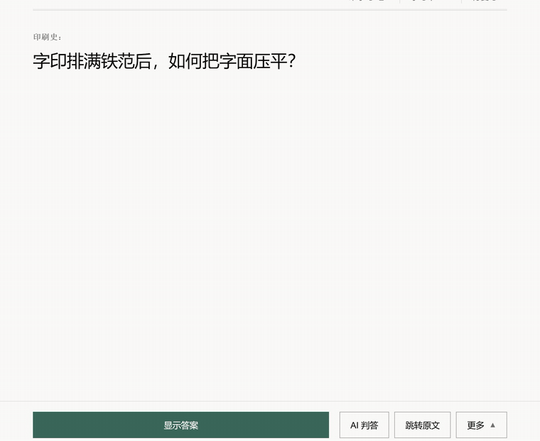
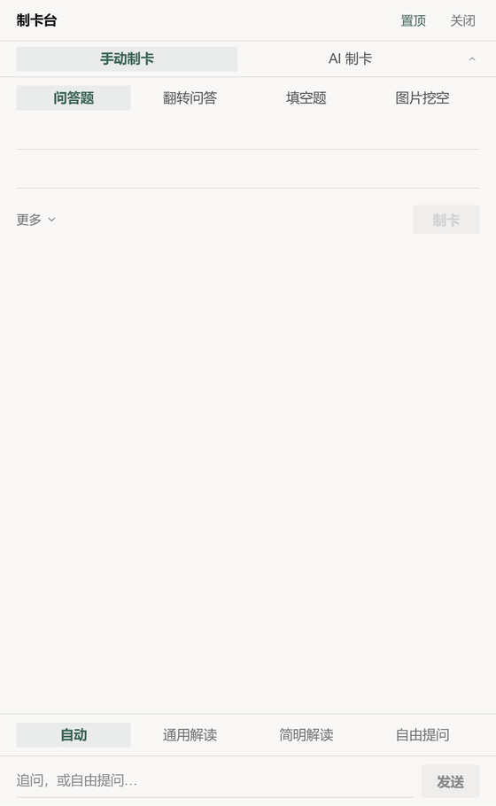
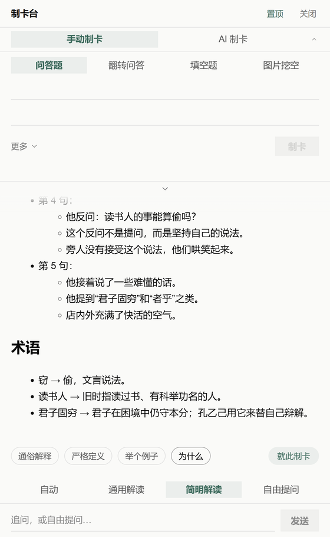

<div align="center">


# Nutation

**本地优先的渐进阅读学习软件 —— 阅读、摘录、记住。**

[](./LICENSE)
[](#快速开始)
[](https://www.electronjs.org/)
[](https://react.dev/)
[](https://www.typescriptlang.org/)


[English](./README.md) | 简体中文 | [日本語](./README.ja.md)

</div>

<div align="center">

<p><sub>阅读现场：正文、摘录与批注在一屏之内。</sub></p>
</div>

Nutation 是把「读」与「记住」放在同一台电脑上的渐进阅读工作台：打开一本书、划出重要的段落、把它变成卡片，再让 FSRS 调度器在合适的时间把它带回来。所有数据都在本地；AI 是可选的，而且只出草稿——没有你的确认，任何内容都不会进入知识库。

## 它如何工作



## 一张结构，两种进入方式

<div align="center">

<p><sub>随文结构 → 结构全景 → 返回。两种视图是同一张结构图。</sub></p>
</div>

**随文结构**在正文右侧，跟着你正在读的段落走。当前节点锚定在原文上；你可以从那里跳到原文、请求讲解、继续深挖，或者打开整张结构图。

**结构全景**把材料放在一张画布上，以你正在读的位置为中心展开。每个组按自己的结构排布——大纲、并列、论证、时间线、步骤、因果、对照——平移缩放、面包屑、关系透视和节点操作都在需要时出现。两种视图之间是 420 ms 的共享元素交接。

有人喜欢先看清整本书的骨架，再回到细节；也有人从一段文字出发，逐层追问。Nutation 两种方向都支持，不规定顺序。

<div align="center">

<p><sub>段落周围的结构：主张、理由、证据，以及它们在整篇材料里的位置。</sub></p>
</div>

导图由你配置的模型生成。生成之后，它就是你本地书库的一部分：随文结构和结构全景都可以离线查看。

## 用 FSRS 安排复习

<div align="center">

<p><sub>显示答案 → 四档评分 → 下一张。</sub></p>
</div>

Nutation 使用 **FSRS-6.0**（`ts-fsrs` 5.4.2）。调度器为每张卡维护稳定性和难度估计，并据此安排下一次复习。21 维权重可以用你自己的 `review_logs`，在设置里通过 `fsrs-rs` 优化器重新训练。训练出的参数是不可变快照：应用它只影响未来调度，不回算任何一张卡的历史。

复习是连续刷题式的：四档评分（重来 / 困难 / 良好 / 简单）、间隔预览（空间允许时显示）、自动下一张、一键撤销、跳转原文再回现场，以及反复遗忘卡片的难点（leech）识别与救援。仪表盘由同一份复习日志推导，没有另一套编造的数字。

FSRS 是开源的调度算法，不是记忆的保证。它决定一张卡什么时候值得再见；那一次复习仍然由你完成。

## 制卡台，离你只有一个快捷键

<div align="center">

<p><sub>Ctrl+Alt+K 呼出独立制卡台；同一个面板也停靠在主窗口右侧。</sub></p>
</div>

制卡台把手动制卡、AI 制卡和 AI 解释放在同一个地方。主窗口里它停靠在右侧（`Ctrl+K`）；按 `Ctrl+Alt+K`，它变成一个独立、置顶的窗口，可以陪你读别的材料。两处是同一个组件，改一处就是改两处。

手动制卡不需要任何 AI 服务。AI 只出草稿；解释板块在底部，提供自动、通用解读、简明解读和自由提问四种方式。切换页签时草稿不会丢；跨页签的幽灵草稿可以用 `Alt+Enter` 一键填入。

## AI 制卡，按材料类型分流

<div align="center">

<p><sub>选中一段文字或粘贴文本；草稿带着材料类型、知识点和确认步骤回来。</sub></p>
</div>

Nutation 在调用模型之前先在本地判断材料类型：默认卡形跟着你选中的文字走。这是一条本地启发式，不是最终裁决——你可以手动覆盖，然后重跑。

| 材料类型 | 默认卡形 |
| --- | --- |
| 概念论述 | 问答（可在确认区转翻转卡） |
| 公式推导 | 问答（LaTeX） |
| 流程背诵 | 问答（顺序续写） |
| 枚举清单 | 挖空 |
| 图片材料 | 图片挖空 |
| 文学 / 诗歌 | 问答 |
| 词汇 / 单词 | 单词四卡（看词识义 / 看义识词 / 听音 / 原句挖空） |

每张草稿都只是提案。你可以编辑正面和背面、把问答转成翻转卡、接受单张或整批、或者整批拒绝。CardLint 会在卡片进入队列前跑一遍本地质检并显示警告。AI 不会在没有你确认的情况下写进知识库；没有 AI 服务时，手动制卡照常可用。

输入是选区或粘贴的文本。产品没有额外的长度上限——实际上限是你所配置模型的上下文窗口。

<details>
<summary>草稿确认面板（静态图）</summary>
<br />
<div align="center">

</div>
</details>

## 简明解读，把边界说清楚

<div align="center">

<p><sub>简明解读：歧义点、逐句解释、多重解读、术语。</sub></p>
</div>

解释板块提供自动、通用解读、简明解读和自由提问。**简明解读**借鉴 ASD-STE100 的清晰表达原则——短句、一句一义、主动语态、受控词汇、不增不减、保留情态——并把它们应用到输出语言上。它不是逐字翻译，也不会把原文的主张简化掉。

输出是结构化的：歧义点（只列语言表达层面的障碍）、逐句解释、确有多种读法时的多重解读，以及一份简短的术语表。目标是让一段难读的文字更容易*进入*，而不是替代它。

Nutation **不是 ASD 的附属产品，也没有获得 ASD 认证**；产品没有内嵌标准原文。解释可能出错，原文仍然是权威。请把输出当作阅读辅助，而不是对原文的验证。

<div align="center">

<p><sub>答案滚动到术语；解读方式栏始终在底部。</sub></p>
</div>

## 还有这些

- **阅读内核 · 一切皆书** —— EPUB、MOBI、AZW3、FB2、CBZ 与 PDF 直接打开；Word、TXT、Markdown、HTML 一键导入成书；粘贴文本也会变成一本书。目录侧栏、滚动与分页双模式、多种纸面外观，进度精确回到上一次的位置。
- **摘录与就地批注** —— 选中一段文字即可摘录，就地批注，在侧栏浏览注解，一条一条地复习摘录，并随时跳回原文现场。
- **仪表盘** —— 阅读 / 摘录 / 复习 / 制卡的一日时间轴、学习热力、到期预测、领域分布与评分构成，全部由你自己的日志推导。
- **卡片浏览器** —— 查询语法、批量操作，以及每张卡当时的 CardLint 质检结果。
- **学习者模型与下一步** —— 用本地学习证据组装的「下一步」面板；学习者记忆以本地 Markdown 文件维护。
- **另外内置** —— 知识点与知识图谱、词典（在线 + 本地 StarDict / DSL / ECDICT）、日记与 AI 洞察、全局快捷键快速记录、UDC 领域分类、皮肤体系，以及全部可自定义的快捷键。

## 为什么叫 Nutation？

植物生长时，尖端会在空中缓缓画圈，感受四周，再选择方向。这种运动叫作 **回旋转头运动（circumnutation）**。它没有地图，也没有标准答案。每一株植物都在用自己的节奏感受世界，找到自己的方向。

**Nutation** 由此得名。

学习也该是这样：没有必修的科目，没有唯一的方向，也没有必须抵达的标准答案。从你自己的环境出发，跟着自己的好奇心，一圈一圈地试探，一点一点地生长。

绕圈不是迷路，是在寻找方向。慢不是落后，是在扎根。

愿每一位学习者，都能像那株幼苗一样，放心地探索，坦然地绕路，最终长成只属于自己的形状。

## 支持的格式

| 格式 | 打开方式 |
| --- | --- |
| EPUB · MOBI · AZW3 · FB2 · CBZ | 阅读内核（foliate-js）原生打开，CFI 锚点定位 |
| PDF | 内置 PDF 阅读 |
| Word (.docx) · TXT · Markdown · HTML | 一键导入成书 |
| 粘贴的文本 | 合成为一本可读的书 |

## 隐私与本地优先

- **零账号** —— 无需注册，打开即用。
- **零远程遥测** —— 没有账号，也没有上传。学习者模型使用的交互信号只保存在你的本地数据目录，不会发送给我们。
- **零云端** —— 本地 SQLite 数据库与本地文件是唯一数据真源。配置 AI 时，请求从你的电脑直接发给你选择的服务商。
- **AI 可选** —— 阅读、摘录、批注、手动制卡与 FSRS 复习不需要 AI 服务；AI 制卡、简明解读和新导图生成需要配置模型。密钥按服务商经系统级存储加密保存，可整体关闭。

## 技术栈

| 层 | 选择 |
| --- | --- |
| 桌面外壳 | Electron 45 + Vite 6 |
| 前端 | React 18 + TypeScript（strict） |
| 阅读内核 | foliate-js（vendored 快照），经防腐层接入，CFI 锚点 |
| 存储 | SQLite（better-sqlite3，WAL），事务写入 + 显式 persist |
| 调度 | `ts-fsrs` 5.4.2（FSRS-6.0）+ `fsrs-rs` 优化器 —— 用你自己的复习日志训练 21 维权重 |
| AI 网关 | OpenAI 兼容流式接口，预设含本地 Ollama / LM Studio，密钥经 safeStorage 加密 |
| 渲染 | markdown-it / react-markdown、KaTeX、Milkdown |
| 打包 | electron-builder —— Windows NSIS 安装包；仓库同时保留 macOS 与 Linux 构建目标 |

## 快速开始

### 下载

前往 [Releases](https://github.com/xiongdy54/Nutation/releases) 页面获取 Windows 安装包。Nutation 需要 **Windows 10/11 64 位（x64 / ARM64）**——不提供 32 位（ia32）版本（Electron 44 起不再发布 Windows 32 位构建）。向导式安装，可自选安装目录；卸载不会删除你的数据。

### 从源码构建

前置要求：[Node.js](https://nodejs.org/) 22.12+ 与 npm。

Linux 上 Electron 还需要系统库——postinstall 会启动 Electron 二进制来验证原生 SQLite 模块：

```bash
# Debian / Ubuntu（Ubuntu 24.04 起 libasound2 改名 libasound2t64）
sudo apt-get install -y libgtk-3-0 libnss3 libxss1 libgbm1 libasound2 xvfb
# Fedora / RHEL / Amazon Linux
sudo dnf install -y gtk3 nss libXScrnSaver mesa-libgbm alsa-lib xorg-x11-server-Xvfb
```

若某个步骤只做构建、不运行 Electron（例如 CI 的构建任务），可设置 `NUTATION_SKIP_ABI_VERIFY=1` 跳过 ABI 验证。

```bash
git clone https://github.com/xiongdy54/Nutation.git
cd Nutation
npm install        # 自动为 Electron 钉住原生 SQLite 模块
npm run dev        # 开发模式（Vite + Electron，热重载）
```

生产构建与打包：

```bash
npm run build      # 构建渲染层产物到 dist/
npm start          # 以构建产物运行应用
npm run dist       # 生成 Windows NSIS 安装包到 release/
npm run dist:mac   # macOS 包（在 macOS 上构建）
npm run dist:linux # Linux 包（在 Linux 上构建）
```

## 数据在哪里

所有数据都保存在你的电脑上：

- 安装版：`%APPDATA%\Nutation\`
- 开发版：`%APPDATA%\Nutation-dev\`

旧的 `incremental-reading-dev` 目录会在首次启动时迁移到新位置；如果改名失败，Nutation 会继续使用旧目录，而不是新建一个空目录。目录里有 `library.db`（书库、卡片、复习日志）、`dictionary.db`、`learner.db`，以及备份与学习者记忆文件。应用内置手动与自动备份，整目录复制即为完整备份。卸载软件不会删除该目录。

## 路线图

- 经 GitHub Releases 的自动更新通道（electron-updater 已接入）
- macOS 签名 / 公证包，以及稳定的 Linux 渠道
- 可选的云同步——本地书库始终是唯一数据真源

Nutation 处于活跃开发中，欢迎反馈与问题报告。

## 贡献

本项目目前以单作者、设计文档驱动的方式开发。问题报告、使用反馈和缺陷复现都非常欢迎——请开一个 [issue](https://github.com/xiongdy54/Nutation/issues)。代码贡献按项目许可证合入。

## 许可

本项目以 [GNU Affero 通用公共许可证 v3.0](./LICENSE) 授权。你可以在该许可证条款下使用、研究、修改与分发 Nutation；若将修改后的版本作为网络服务提供，AGPL 要求向用户提供对应源代码。

## 致谢

- [foliate-js](https://github.com/johnfactotum/foliate-js) —— EPUB / MOBI 阅读内核
- [ts-fsrs](https://github.com/open-spaced-repetition/ts-fsrs) 与 [fsrs-rs](https://github.com/open-spaced-repetition/fsrs-rs) —— FSRS 调度器与优化器（Open Spaced Repetition）
- [SuperMemo](https://www.supermemo.com/) —— 本项目所借鉴的渐进阅读方法论
- Electron · React · Vite · better-sqlite3 · pdf.js · KaTeX · Milkdown，以及它们周围的整个开源生态

<details>
<summary>关于演示库与 AI 演示文本</summary>

截图使用一套由公有领域节选组成的演示库：鲁迅《孔乙己》（中文界面）与柯南·道尔《波希米亚丑闻》（英文界面）。

动图中的 AI 回复通过 Nutation 真实的 AI 网关，由本地确定性测试服务流式返回。界面、流式链路、草稿、编辑与确认步骤都是真实应用；回复文本预先写好，是为了让演示可复现。这里不暗示任何具体商业模型。

中文 README 使用中文界面截图；英文 README 使用英文界面截图；日文 README 使用英文截图。应用界面本身支持简体中文、繁体中文、English 与日本語。

</details>
