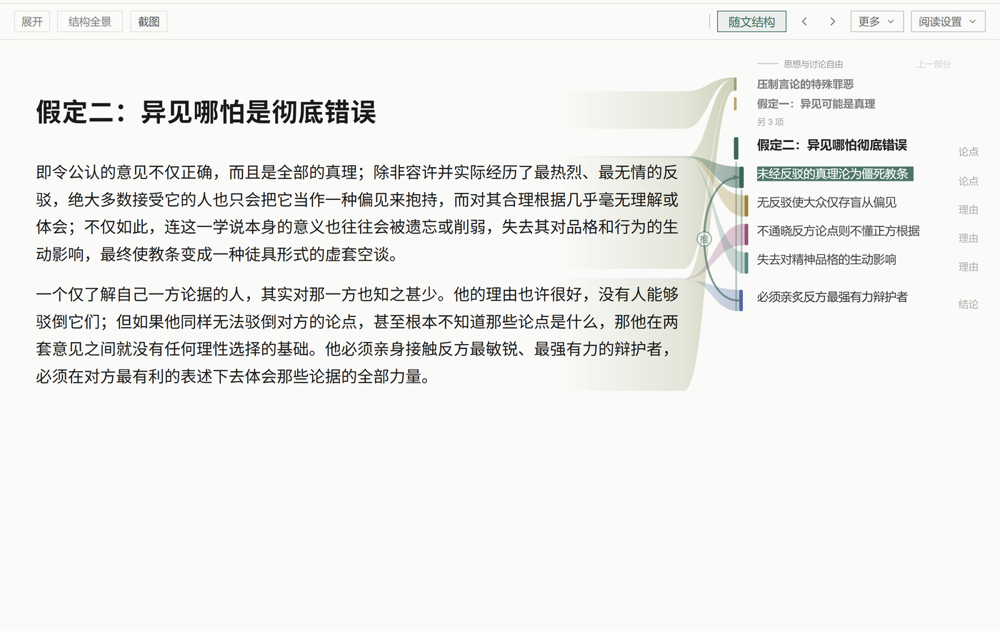
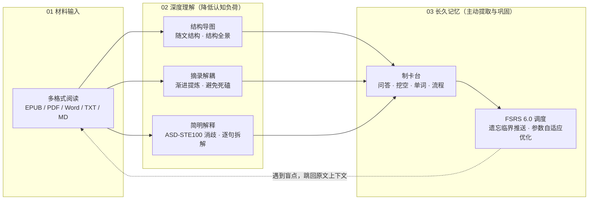

<div align="center">


# Nutation

**先理解，后记住。将完整学习闭环融于一体的本地优先工作台。**

[](./LICENSE)
[](#快速开始)
[](https://www.electronjs.org/)
[](https://react.dev/)
[](https://www.typescriptlang.org/)


[English](./README.md) | 简体中文 | [日本語](./README.ja.md)

</div>

<div align="center">

<p><sub>阅读现场：沉浸阅读连续正文，右侧随文结构贴身梳理论证脉络，微观论述与宏观框架一目了然。</sub></p>
</div>

学习的本质，是**先透彻理解，再长久记住**。

没有理解的记忆是机械的死记硬背，难以维持且无法迁移；没有记忆的理解则是瞬时的灵光乍现，随时间迅速衰退。市面上的工具往往将二者割裂——阅读器只负责浏览，笔记软件堆砌资料，制卡软件只管机械刷题。

**Nutation** 将「材料阅读」、「深度理解」与「长久记忆」融于同一套工作流中。从书籍、论文导入，到拆解认知障碍，再到科学安排复习，一切都在你的本地工作台中独立闭环运行。

---

## 核心设计：理解与记忆的认知闭环



---

## 一、深度理解：建立图式与拆解阻碍

认知心理学研究指出：在学习新知识时，若缺乏整体框架或被生涩词句打断，工作记忆极易过载。Nutation 提供了三种相互配合的理解工具：

### 1. 结构导图：先见森林，再见树木

<div align="center">
<video src="docs/assets/readme/structure-zh.mp4" controls width="100%"></video>
<p><sub>随文结构 → 结构全景 → 返回阅读。宏观结构与微观论述自由切换。</sub></p>
</div>

认知科学与先行组织者（Advance Organizer）理论研究表明：**在深入细节之前先建立宏观结构认知，学习效率与理解深度显著更高**。Nutation 提供两种无缝联动的结构视图：

- **随文结构**：阅读过程中如影随形贴在段落侧方，展示当前文字在整节论述中的层级位置，支持一键定位与深挖；
- **结构全景**：整篇材料的全局认知画布。将全书论点、证据、时间线与对比关系全局铺开，使学习者既能俯瞰宏观脉络，又能随时聚焦当前论述。

### 2. 摘录卡片：渐进阅读与难点解耦

借鉴 SuperMemo 创始人 Piotr Woźniak 的“渐进阅读”（Incremental Reading）哲学：**一次通读几乎不可能完全掌握所有深奥概念；遇到暂时无法消化的难点，死磕只会挫伤心流**。

- 将复杂段落摘录剥离出来，赋予独立批注与优先级，留待后续多轮消化；
- 摘录保留完备的原书上下文与 CFI 锚点，一键即可随时穿梭回原文现场。

### 3. AI 简明解释：工程级语言降噪

学术著作或专业资料常充斥着长难从句、多义术语与含糊表达。Nutation 的 AI 解释功能借鉴了航空航天工业严苛的 **ASD-STE100（简明技术英语规范）** 理念，并进行了多语言工程适配：

- **消除语义歧义**：单独提取段落中存在语法、修辞歧义的关键节点；
- **逐句拆解还原**：严格遵守“短句”与“一句话只表达一个意图”的原则，剥离嵌套从句，重构清晰逻辑链条；
- **术语独立定义**：将核心术语抽离在专用术语表中，保持原文主张与不确定性，不增不减、不作过度低幼化的摘要，直达文字背后的真实含义。

<div align="center">
<video src="docs/assets/readme/ai-explain-zh.mp4" controls width="560"></video>
<p><sub>简明解释：提取歧义、逐句拆解单意图短句、提取专业术语。</sub></p>
</div>

---

## 二、长久记忆：主动提取与 FSRS 算法

大脑对单次输入的信息具有极高的遗忘倾向（艾宾浩斯遗忘曲线）。要把短期工作记忆固化为长期记忆，必须依赖**定时的主动提取（Active Recall）与间隔重复（Spaced Repetition）**。

<div align="center">
<video src="docs/assets/readme/fsrs-zh.mp4" controls width="760"></video>
<p><sub>FSRS 复习会话：呈现问题 → 3D 翻面核对 → 四档评分反馈。</sub></p>
</div>

### 1. 多模态制卡台（Workbench）

在阅读现场或摘录列表，随时通过 `Ctrl+K`（主窗停靠）或 `Ctrl+Alt+K`（独立置顶窗口）呼出制卡台：

- **语义卡型路由**：针对概念论述（问答卡）、公式推导（LaTeX 问答）、流程步骤（顺序续写卡）、枚举清单（挖空卡）及语言学习（单词四卡）提供精准卡片支持；
- **屏幕截图与图片遮挡制卡（Image Occlusion）**：随时呼出独立置顶制卡台，点击「图片挖空」截取屏幕任意区域（如浏览器中的论文插图、解剖图谱、网络架构图或课件），无缝载入图片挖空编辑器，支持矩形、椭圆、多边形等多种形状自由拖拽遮蔽，素材自动归档至本地专属资产库；
- **CardLint 质量检查**：纯本地静态质检引擎（对 AI 与手动制卡一视同仁）。基于 Piotr Wozniak 知识表述原则，不仅严格把关原子化与最小信息原则（拦截答案过载、正面过长与挖空过多），更深度检查认知陷阱（拦截是否判断题、宽泛集合题，强制集合问答标注合格线）、严防前缀泄题（检查上下文前缀并拦截答案泄露）、核查学术严谨性（观点归属与实体全名规范）、提示易变内容时间戳，并协同本地相似检索防范重复与冲突。

<div align="center">
<video src="docs/assets/readme/occlusion-zh.mp4" controls width="760"></video>
<p><sub>跨应用截图与图片遮挡制卡全闭环：全局快捷键呼出制卡台 → 拖拽框选屏幕插图（经典麻婆豆腐菜谱配方） → 矩形/椭圆精确遮蔽关键配料考点 → 一键制卡并跳转复习页面完成正面遮挡、背面揭示与 FSRS 评分全闭环。</sub></p>
</div>

### 2. 采用卓越的 FSRS 6.0 间隔重复算法

在复习调度上，我们特别由衷感谢开源开发者 **[Jarrett Ye (L-M-Sherlock)](https://github.com/L-M-Sherlock)** 及其所领导的开源组织 **[Open Spaced Repetition](https://github.com/open-spaced-repetition)** 开发并无私开源了现代间隔重复算法 FSRS。

Nutation 采用了最新的 **FSRS 6.0 算法**（基于 `ts-fsrs` 5.4.2 引擎）：

- **精准科学调度**：基于卡片的**稳定性（Stability）、可提取性（Retrievability）与难度（Difficulty）**三维状态，精算下一次复习时间，仅在知识即将遗忘的临界点精准推送，以更少、更合理的复习次数维持极高记忆留存率；
- **参数自适应训练（用得越多，算得越准）**：内置 `fsrs-rs` 优化器，可直接读取你在本机日积月累的真实复习日志（`review_logs`），一键重新训练 21 维个性化权重参数，完美贴合你个人的遗忘特质。

---

## 隐私与纯本地优先（Local-First）

- **零账号，零遥测**：不设注册登录，不收集、不上传任何浏览数据、卡片记录或个人日志。
- **本地数据独占**：所有书库、摘录、卡片与调度状态存储于本地 SQLite 数据库（WAL 模式 + 事务强一致落盘）。
- **AI 纯属可选且受控**：离线阅读、随文摘录、手动制卡与 FSRS 复习 100% 离线可用；AI 仅用于辅助生成草稿与解释，没有你的逐条确认，任何 AI 生成物都不会写入知识库。

---

## 支持格式与阅读内核

| 格式                                       | 引擎 / 处理方式               | 核心特性                      |
| ---------------------------------------- | ----------------------- | ------------------------- |
| **EPUB · MOBI · AZW3 · FB2 · CBZ**       | 基于 foliate-js 深度定制的阅读内核 | 严格保持 CFI 规范，换设备/重排版不丢划线锚点 |
| **PDF**                                  | 原生 PDF 渲染器              | 高性能滚动与跨页连续高亮              |
| **Word (.docx) · TXT · Markdown · HTML** | 一键导入转换为本地图书             | 保留层级标题结构与图片               |
| **剪贴板文本**                                | 一键合成书籍                  | 随时抓取长篇网页与碎片资料归档           |

---

## 快速开始

### 系统要求与安装

- 支持 **Windows 10 / Windows 11 64 位（x64 / ARM64）**。
- 请前往 [GitHub Releases](https://github.com/xiongdy54/Nutation/releases) 下载最新安装包（`.exe`），安装向导支持自定义路径，覆盖升级与卸载均绝不破坏你的本地数据库。

### 从源码运行

```bash
git clone https://github.com/xiongdy54/Nutation.git
cd Nutation
npm install        # 自动配置匹配 Electron ABI 的原生 SQLite 模块
npm run dev        # 启动 Vite + Electron 热重载开发环境
npm run build      # 编译渲染层
npm run dist       # 打包生产安装包
```

---

## 名字的来源：为什么叫 Nutation？

植物在生长发育过程中，其幼茎顶端会在三维空间中缓缓画出螺旋轨迹，一边感知外界阳光与重力，一边调整姿态、探索方向。在生物学中，这一自主运动被称为**回旋转头运动（circumnutation）**。

真实的学习从来不是在一条既定跑道上机械冲刺，而是像生长的幼苗一样：从你当下的环境出发，带着好奇心一圈圈试探，遇到难点绕道扎根，读懂一点便生长一寸。

愿每一位学习者，都能拥有属于自己的生长节奏与精神家园。

---

## 开源许可与致谢

- 遵循 **[GNU AGPL v3.0](./LICENSE)** 许可证开放源代码。

- 特别致谢 **[Jarrett Ye (L-M-Sherlock)](https://github.com/L-M-Sherlock)** 与 **[Open Spaced Repetition](https://github.com/open-spaced-repetition)** —— 感谢作者与团队开发并开源了卓越的 FSRS 算法调度器（ts-fsrs）与优化器（fsrs-rs）。

- 感谢 [foliate-js](https://github.com/johnfactotum/foliate-js)、[SuperMemo](https://www.supermemo.com/)，以及 Electron、React、better-sqlite3、KaTeX 等优秀开源基石。

---

<details>
<summary>演示书库与视频说明</summary>

演示视频与截图使用的演示书库来自公有领域经典文本：中文界面使用约翰·斯图尔特·密尔《论自由》第二章，日文界面使用约翰·斯图尔特·密尔《自由论》第二章，英文界面使用查尔斯·达尔文《物种起源》第三章。文字本身未改写。图片挖空演示使用的麻婆豆腐菜谱图解为精制演示素材。

演示视频中的随文结构交接、全景导图导航、跨应用截图与图片遮挡制卡及复习闭环（经典麻婆豆腐菜谱配方）、FSRS 3D 翻面评分闭环（严格遵守最小信息原则 R2）、ASD-STE100 简明解释流式输出均在 Nutation 真实软件界面上录制（60fps 高清），流式链路与输出格式严格对齐产品真实流程。

</details>
